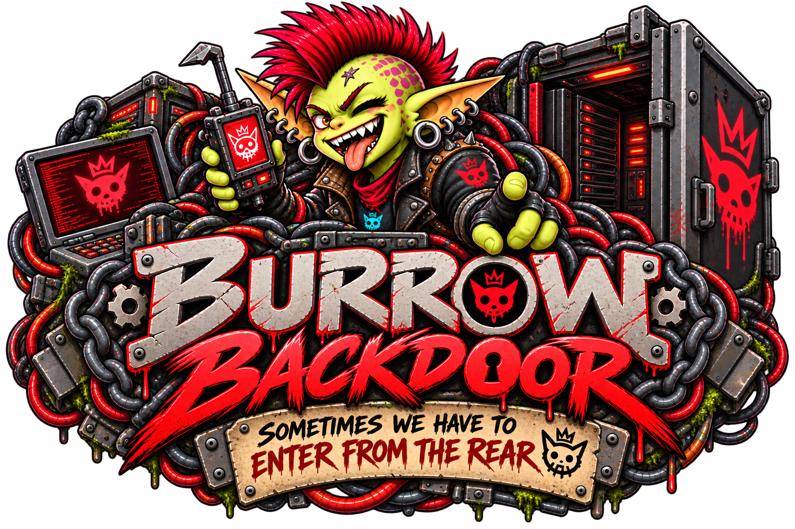

# Burrow Backdoor

*Sometimes we have to enter from the rear.*

A controlled route into the **home Burrow that hosts your agent**. Inspect runtime diagnostics, understand stalled work, and let selected agents manage mods or use the full Core API through explicit Core grants.

[Install Backdoor](installation.md){ .md-button .md-button--primary }
[Explore the tools](tools.md){ .md-button }

!!! danger "Real access. Real consequences."
    Backdoor includes durable tools that can install, update, enable, disable, and uninstall mods. Its separately approved full API tool can perform every Core API read and write, including private data access, settings changes and deletion, without diagnostic sanitization. Grant each capability only to trusted administrators. Global diagnostics can reveal other agents’ activity; even bounded diagnostics can be private. Review inputs and redact outputs before sharing.

## What it does

- **26 diagnostic tools** for health, sessions, traces, context, run proofs, Brains metadata, Forge, and mods.
- **8 administrative tools** for inventory, refreshing configured sources, mod lifecycle changes, and durable operation status.
- **One full Core API tool**, `burrow_api_request`, for any relative `/api` route and method, including Archive and future endpoints. Discover the running API with `GET /api/openapi.json`.
- **Two independent access lists**: global diagnostics and administration. Ordinary agents retain caller-scoped diagnostics.
- **Two independent administrative capability grants**: durable mod management and full API access; the latter is never implied by the former.
- **Core-owned identity and authority**: tool arguments cannot choose who is making the call.

Backdoor works inside Burrow. There is no separate MCP server, API token, listener, or container to configure. If an agent uses Node Goblin for remote execution, Backdoor still targets its home Burrow, not that remote machine.

## Choose your path

| Goal | Start here |
| --- | --- |
| Set it up | [Install and enable](installation.md) |
| Select trusted agents | [Agent access](access.md) |
| Investigate a stuck session | [Diagnostic workflow](diagnostics.md) |
| Update or disable a mod | [Manage mods](administration.md) |
| Use the running Core API | [Full API tool reference](tools.md#burrow_api_request) |
| Understand a queued or interrupted change | [Operations and recovery](operations.md) |

See the [public source](https://github.com/GoblinKing-Burrow/Burrow-Backdoor), [Burrow guide](https://burrow-docs.blissful-psychosis.com/), and [Node Goblin guide](https://nodegoblin-docs.blissful-psychosis.com/).
